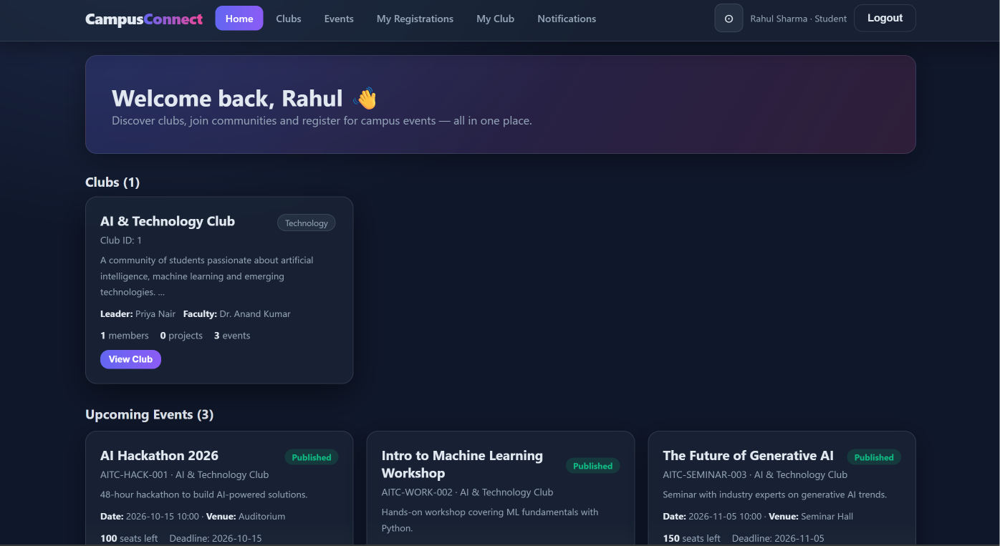
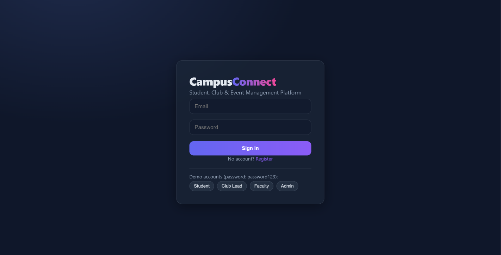
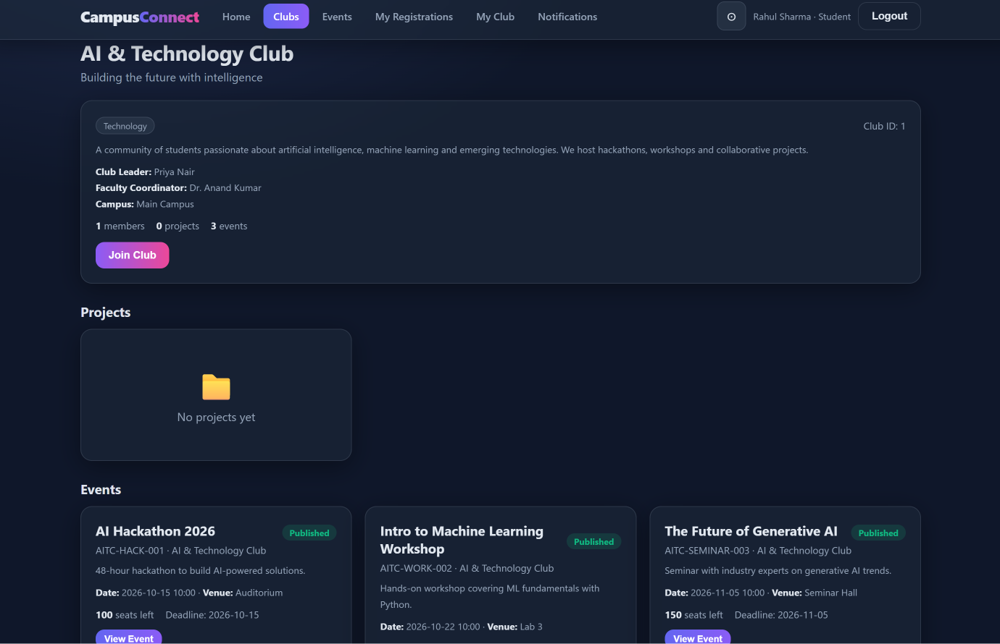
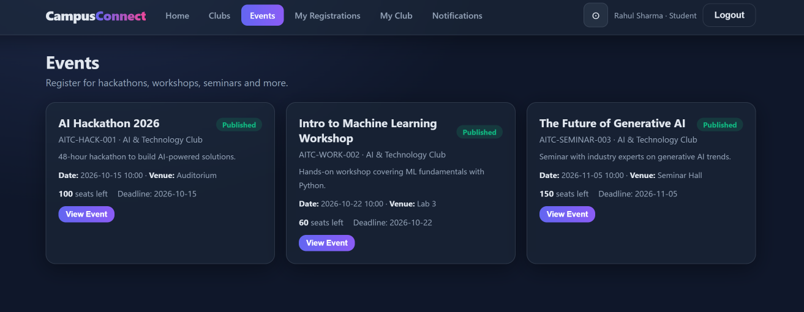
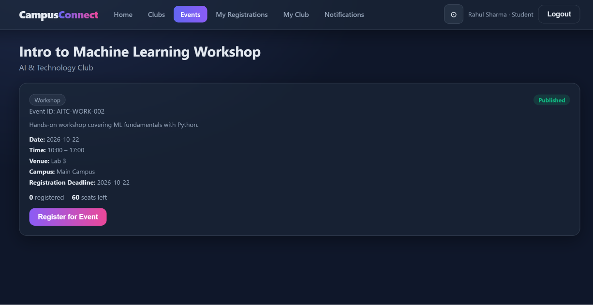
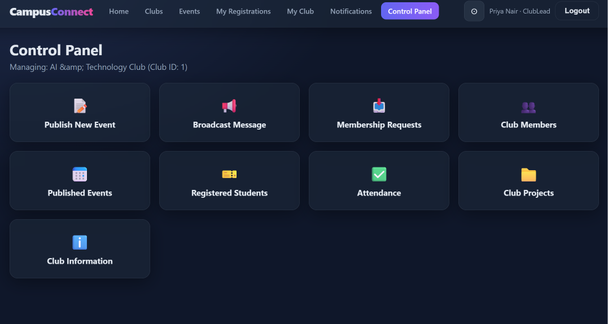

# CampusConnect

**A student club and event management platform** — students discover clubs, request membership and register for events, while club leads publish events, approve members, broadcast updates and mark attendance.




---

## Screenshots

| Login (demo accounts) | Club details |
| --- | --- |
|  |  |
| **Events** | **Event registration** |
|  |  |

**Club Lead control panel**



---

## Features

**Students**
- Browse clubs and upcoming events
- Request to join a club (duplicate requests are rejected)
- Register for events with live seat counts; view "My Registrations"
- In-app notifications

**Club Leads**
- Publish events, broadcast messages to members
- Approve or reject membership requests
- View registered students and mark attendance
- Manage club projects and club information

**Security**
- JWT authentication; the user's role travels in the token
- Role-based access control with a `@role_required(...)` decorator
- A club lead's club is always looked up from their own identity in the database, never taken from the request, so one lead cannot manage another club

---

## Tech stack

| Layer | Technology |
| --- | --- |
| Backend | Python, Flask, Flask-SQLAlchemy, Flask-JWT-Extended, Flask-CORS |
| Database | MySQL 8.0 (SQLite for quick local runs) |
| Frontend | HTML, CSS, vanilla JavaScript single-page app (hash routing) |
| DevOps | Docker, Docker Compose, Gunicorn |

## Architecture

```
Browser (SPA) ──REST/JSON──► Flask routes ──► RBAC checks ──► SQLAlchemy models ──► MySQL
                 JWT in header
```

**Data model (10 tables):** User, Club, ClubMember, ClubMembershipRequest, Event, EventRegistration (unique per event + user), Attendance (unique per event + user), Broadcast, Project, Notification.

API routes live in `app/routes/` (auth, clubs, memberships, events, broadcasts, projects, notifications, my).

---

## Run it

### Option 1: Docker (MySQL)

```bash
docker compose up --build
```
Open http://localhost:5000

### Option 2: Local with SQLite

**Windows (PowerShell)**
```powershell
python -m venv venv
venv\Scripts\python.exe -m pip install -r requirements.txt
$env:DATABASE_URL="sqlite:///campusconnect.db"
venv\Scripts\python.exe seed.py
venv\Scripts\python.exe run.py
```

**macOS / Linux**
```bash
python3 -m venv venv && source venv/bin/activate
pip install -r requirements.txt
export DATABASE_URL=sqlite:///campusconnect.db
python seed.py && python run.py
```
Open http://localhost:5000

### Demo accounts (password: `password123`)

| Role | Email |
| --- | --- |
| Student | student@campusconnect.com |
| Club Lead | clublead@campusconnect.com |
| Faculty Coordinator | faculty@campusconnect.com |
| Admin | admin@campusconnect.com |

---

## Project structure

```
campus_connect/
├── app/
│   ├── __init__.py      # app factory
│   ├── config.py        # settings from environment variables
│   ├── models.py        # 10 SQLAlchemy models
│   ├── utils.py         # role_required, club ownership checks
│   ├── routes/          # REST API blueprints
│   ├── static/          # CSS + SPA JavaScript
│   └── templates/       # index.html
├── seed.py              # demo data (safe to re-run)
├── run.py
├── Dockerfile
└── docker-compose.yml
```

## Author

**Hirthesh R** · [LinkedIn](https://www.linkedin.com/in/hirthesh-r-ab47a330b) · [GitHub](https://github.com/Hirthesh-R)
